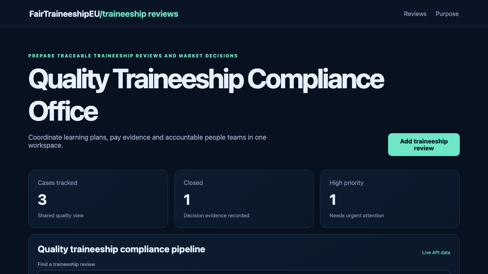

# Quality Traineeship Compliance Office

## One-sentence benefit
Helps employers and public authorities coordinate learning plans, fair conditions and inclusive traineeship reviews.

## Live demo
Run the Java service and React application locally to use the complete experience.

## Screenshots

## Main features
Search and sort traineeship reviews, add validated actions, move work through approval, and see live priorities and progress.

## Technology used
React, TypeScript, TanStack Query, Wouter, Vite, Spring Boot and Java.

## Installation instructions
Start the backend with `cd backend && mvn spring-boot:run`. In another terminal run `npm install && npm run dev`.

## Commercial licensing/contact
Commercial licensing and implementation support are available through the repository owner.

## Business problem and users
People teams, employment authorities, mentors and trainee representatives need a shared view of evidence gaps, quality actions and accountable owners.

## Key workflows
Teams can find a traineeship review, create an action, validate required details, and advance it from draft to review and closure.

## React framework highlights
The interface uses focused components, controlled forms, route-based pages, query caching and mutation-driven API updates.

## Java backend highlights
The Spring Boot service provides real list, search, create and update endpoints, validation, clear errors, health reporting and tests.

## Architecture and state flow
React reads server state through TanStack Query. Successful mutations invalidate the shared list so the latest backend record is shown.

## Accessibility and responsive behaviour
Semantic regions, explicit labels, visible focus, status text, strong contrast and compact mobile layouts support keyboard and small-screen use.

## Verification commands
Use `npm test`, `npm run lint`, `npm run build`, and `cd backend && mvn test package`.

## Structure
`src` contains the React experience, `backend` contains the Java service, and `docs` contains verified media.

## Tradeoffs
The demonstration keeps records in memory for a fast local start; production use would add persistent storage, identity and audit retention.

## Roadmap
Add pay benchmarks, learning-plan templates, trainee feedback, mentoring evidence and durable audit storage.
